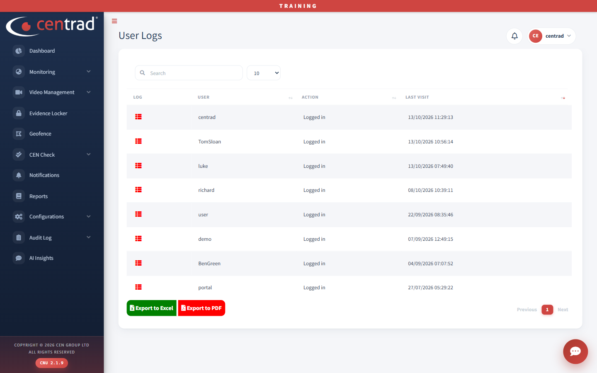

# User Logs

See when users last used the portal.

## On the page
- Type in the search box to find a user.
- Click **Export to Excel** or **Export to PDF** to save the list.

The columns are **Log**, **User**, **Action** (for example *Logged in*) and **Last Visit**.

## See also
- [User Masters](../configurations/user-masters.md)
