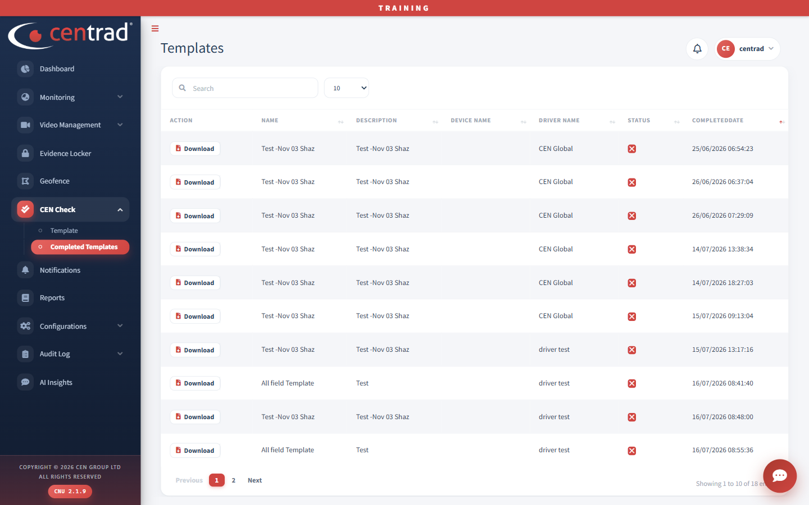

# Completed Templates

See the checks that have been completed.

## On the page
- Click **Download** on a row to save a completed check.
- Use the search box to find a row.

The columns are **Action**, **Name**, **Description**, **Device Name**, **Driver Name**, **Status** and **CompletedDate**.

## See also
- [Template](templates.md)
