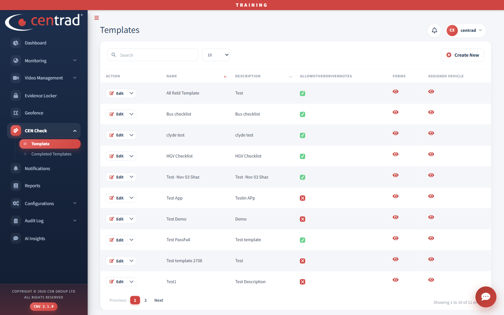
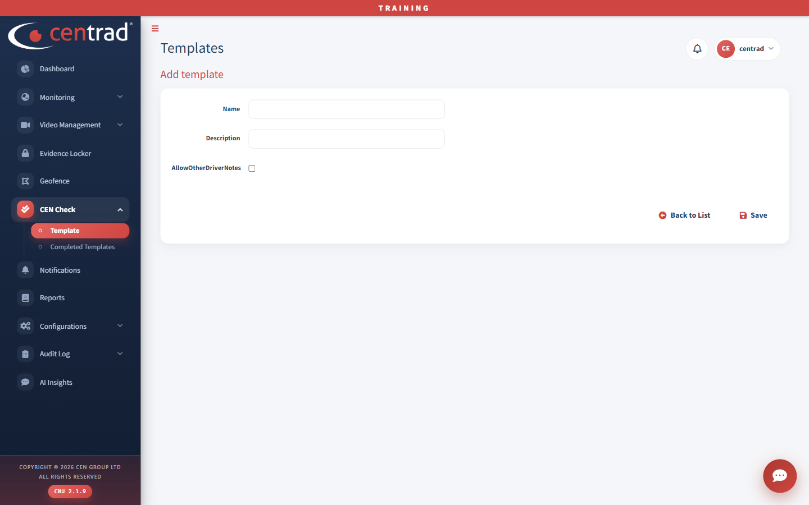

# Template

See your CEN Check templates and add new ones.

## The list
- Click **Create New** to add a template.
- Under **Forms**, click the eye icon to see a template's forms.
- Under **Assigned Vehicle**, click the eye icon to see the vehicles it is assigned to.
- Use the search box to find a template.

The other columns are **Action** (an **Edit** button), **Name**, **Description** and **AllowOtherDriverNotes** (a tick or a cross).

## Add a template
1. Click **Create New**.
2. Type a **Name** and a **Description**.
3. Tick **AllowOtherDriverNotes** if you need it.
4. Click **Save**. Click **Back to List** to leave without saving.

## See also
- [Completed Templates](completed-templates.md)
- [Asset Management](../configurations/asset-management.md)
