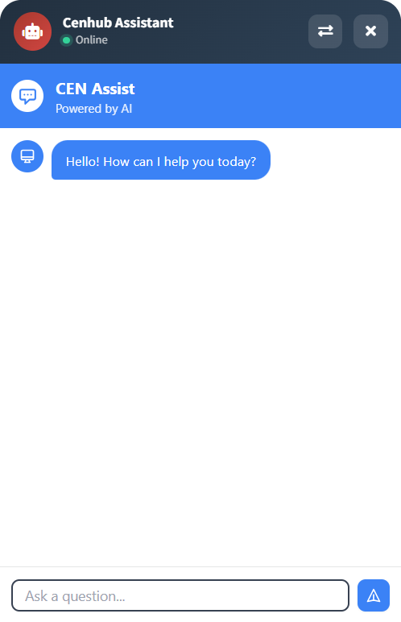

# Cenhub Assistant

Ask questions and get answers without leaving the portal. The assistant is an AI chat that is available on every page.

{ width="320" }

## Before you start
- The assistant must be turned on for your account. If you don't see the chat button, ask your administrator.

## Ask a question
1. Open the chat window from the chat button on any page.
2. Type your question in **Ask a question**.
3. Press **Enter**, or click the send button at the bottom right of the window.

The answer appears in the chat window. You can keep asking follow-up questions in the same conversation.

## The chat window
- **Name and status (top left):** the assistant's name. A green dot and **Online** show it is ready.
- **Switch assistant (top right):** click the arrows button to choose a different assistant from the list.
- **Close (top right):** click **X** to close the chat window. Your page stays as it was.

!!! note
    The assistant is powered by AI. Check important answers before you act on them.

## See also
- [AI Insights](ai-insights.md)
- [Sign in and find your way around](quick-start/sign-in-and-interface.md)
