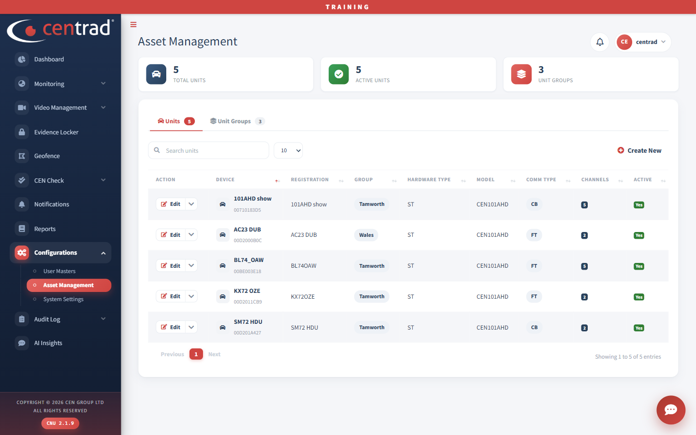
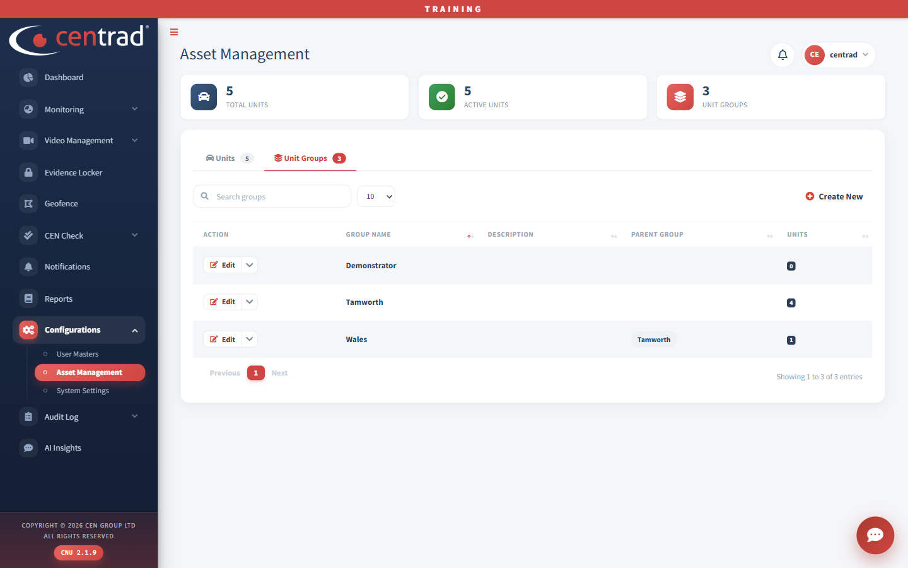

# Asset Management

See your units (vehicles) and your unit groups.

Three boxes at the top show **Total Units**, **Active Units** and **Unit Groups**. Below them are two tabs: **Units** and **Unit Groups**.

## Units
- Type in **Search units** to find a unit.
- Click **Create New** to add one.

The columns are **Action** (an **Edit** button), **Device** (the name and ID), **Registration**, **Group**, **Hardware Type**, **Model**, **Comm Type**, **Channels** and **Active**.

## Unit Groups
Click the **Unit Groups** tab.

- Type in **Search groups** to find a group.
- Click **Create New** to add one.

The columns are **Action**, **Group Name**, **Description**, **Parent Group** and **Units**, which is the number of units in the group.

## See also
- [Manage Vehicles](manage-vehicles.md)
- [Live Tracking](../monitoring/live-tracking.md)
- [User Masters](user-masters.md)
