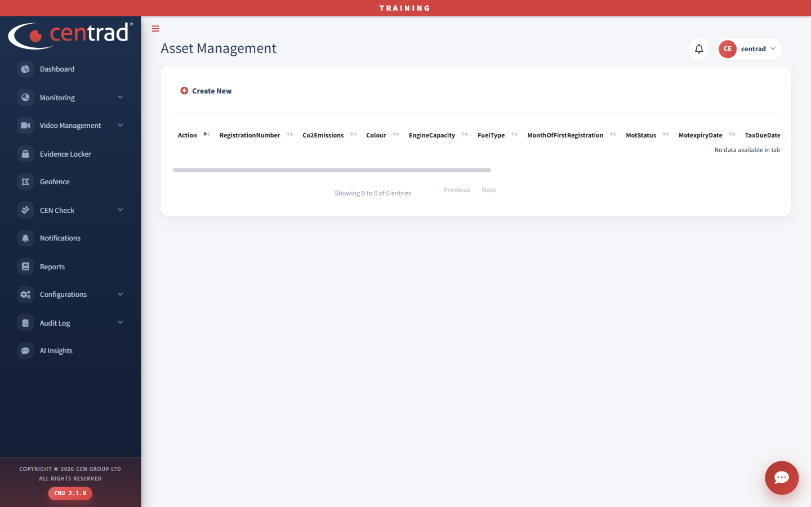

# Manage Vehicles

A register of vehicles. Open it with the **Manage vehicles** link on the [Dashboard](../dashboard.md). Its page heading is **Asset Management**, but it is a different page from [Asset Management](asset-management.md) in the Configurations menu.

## On the page
- Click **Create New** to add a vehicle.
- The columns include **RegistrationNumber**, **Co2Emissions**, **Colour**, **EngineCapacity**, **FuelType**, **MonthOfFirstRegistration**, **MotStatus**, **MotexpiryDate** and **TaxDueDate**.

The list was empty when this page was captured, so the screenshot shows only the column headings.

## See also
- [Asset Management](asset-management.md)
- [Dashboard](../dashboard.md)
