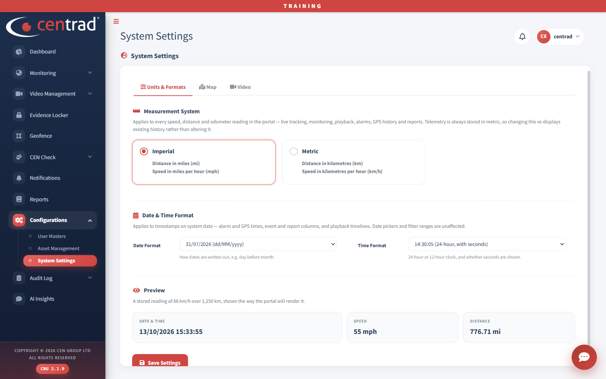

# System Settings

Choose how speeds, distances, dates and times are shown.

The page has three tabs: **Units & Formats**, **Map** and **Video**.

## Change the units and formats
1. Open **Configurations > System Settings**.
2. Under **Measurement System**, choose **Imperial** (miles and miles per hour) or **Metric** (kilometres and kilometres per hour). The page says this applies to every speed, distance and odometer reading in the portal. It also says changing it only changes how existing history is shown, not the history itself.
3. Under **Date & Time Format**, choose a **Date Format** (for example *31/07/2026 (dd/MM/yyyy)*) and a **Time Format** (for example *14:30:05 (24-hour, with seconds)*).
4. Check **Preview**. It shows how a date and time, a speed and a distance will look.
5. Click **Save Settings**.

## See also
- [User Masters](user-masters.md)
- [Reports](../reports.md)
