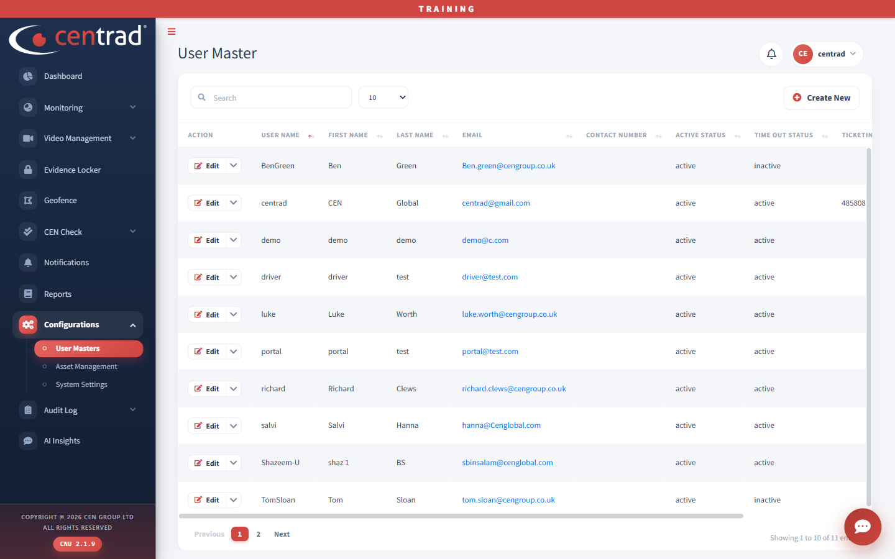
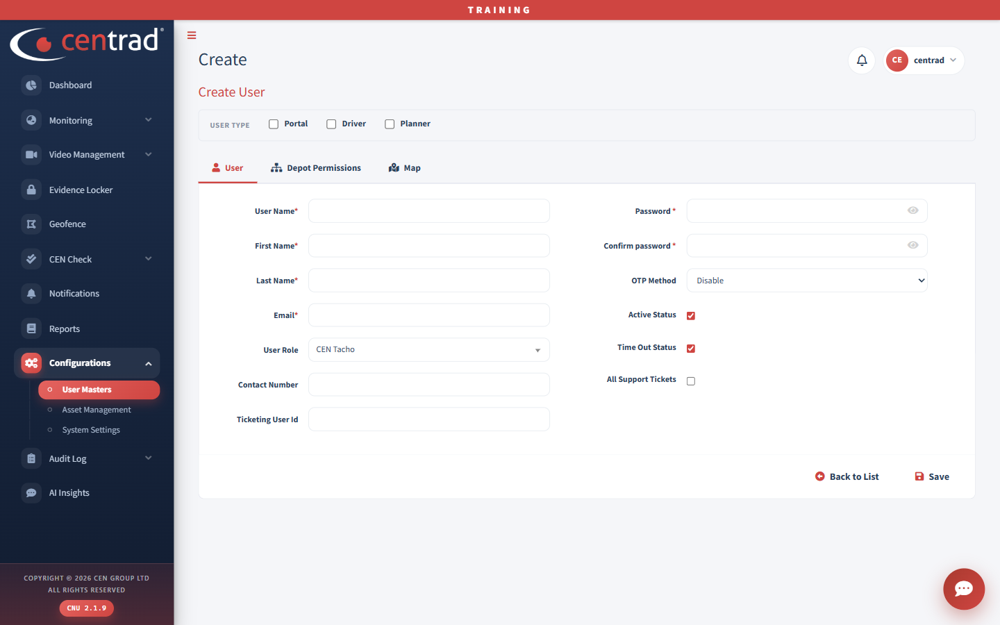

# User Masters

See the portal's users and add new ones.

## The list
Use the search box to find a user. Click **Edit** on a row to change that user, or **Create New** to add one.

The list shows **User Name**, **First Name**, **Last Name**, **Email**, **Contact Number**, **Active Status**, **Time Out Status** and **Ticketing**.

## Create a user
1. Click **Create New**.
2. Tick the **User type**: **Portal**, **Driver** or **Planner**.
3. On the **User** tab, fill in **User Name**, **First Name**, **Last Name** and **Email**. These are required.
4. Choose the **User Role**. Add the **Contact Number** and **Ticketing User Id** if you need them.
5. Type the **Password**, and type it again in **Confirm password**.
6. Choose the **OTP Method**. It starts on *Disable*.
7. Set **Active Status**, **Time Out Status** and **All Support Tickets**. The first two start ticked.
8. Click **Save**. Click **Back to List** to leave without saving.

The form also has **Depot Permissions** and **Map** tabs.

## See also
- [Asset Management](asset-management.md)
- [User Logs](../audit-log/user-logs.md)
- [System Settings](system-settings.md)
