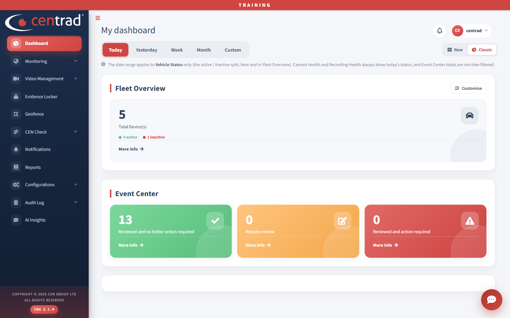

# Dashboard

See your whole fleet at a glance: vehicles, online and offline, cameras, events and fleet health. It is the first page you see after you sign in.

## On the page
- **Tiles:** *Total vehicles*, *Online*, *Offline*, *Cameras online*, *AI events* and *Evidence requests*. Percentages show the share of the fleet.
- **Fleet location:** a map of your vehicles, with a legend for Online, Offline and Alarm.
- **Events requiring attention:** events waiting for review. Click **View all** to see them.
- **Fleet health (CEN checks):** the share of the fleet that is healthy, with counts for **Recording OK**, **Camera faults**, **Device offline** and **GPS lost**. Click **View details** for more.

## Change what the page shows
- Click **Customise** to choose what the page shows.
- Use the **New / Classic** switch at the top right to change layout.

## Classic dashboard
Click **Classic** to switch to the classic layout.

- **Period buttons:** choose **Today**, **Yesterday**, **Week**, **Month** or **Custom**. The page notes that the period only changes the active and inactive split. Camera health and recording health always show today's status, and Event Center totals are not filtered by date.
- **Fleet Overview:** the total number of devices, and how many are active and inactive. Click **More info** for details.
- **Event Center:** three cards for events that were reviewed with no further action, events that need review, and events reviewed where action is required.

## See also
- [Live Tracking](monitoring/live-tracking.md)
- [Event Center](video-management/event-center.md)
- [Evidence Locker](evidence-locker.md)
