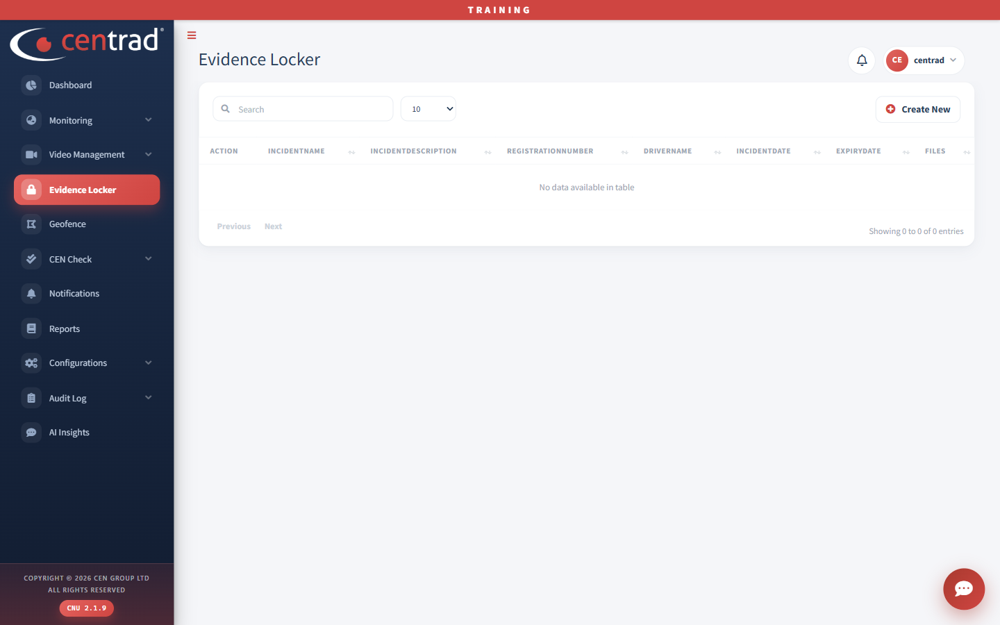

# Evidence Locker

Keep a record of an incident, with its details and files.

## The list
The list shows **IncidentName**, **IncidentDescription**, **RegistrationNumber**, **DriverName**, **IncidentDate**, **ExpiryDate** and **Files**. Use the search box to find a record.

## Add evidence
1. Click **Create New**.
2. Fill in **Incident Name**, **Incident Description** and **Registration Number**. These are required. Add the **Driver Name** if you have it.
3. Choose the **Incident Date** and the **Expiry Date**. Both are required.
4. Under **Attach file**, click **Local File**, **Events File** or **Video Download File** to add files. Added files appear in a table with **Action**, **Filename** and **Source**.
5. Click **Save**. Click **Back to List** to leave without saving.

## See also
- [Video Downloads](video-management/video-downloads.md)
- [Event Center](video-management/event-center.md)
- [Add evidence (quick start)](quick-start/add-evidence.md)
