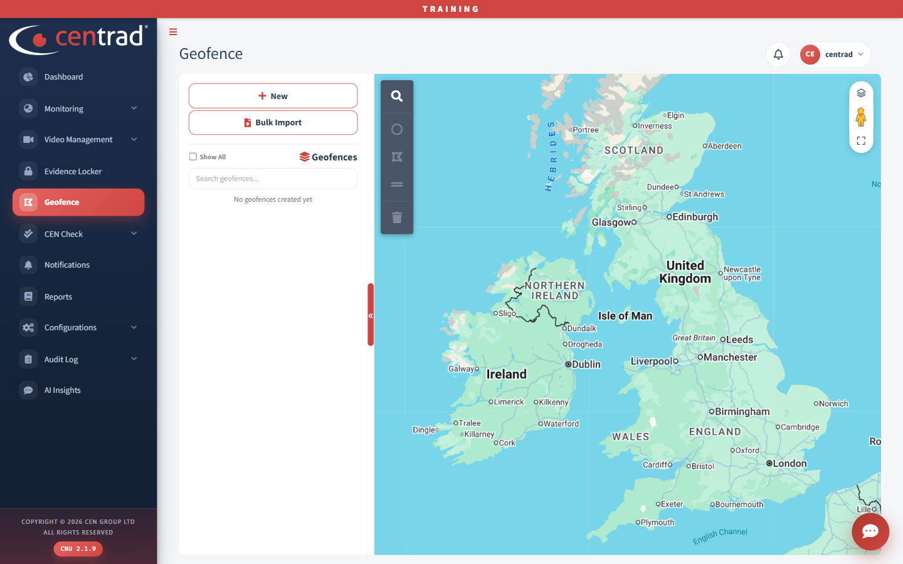

# Geofence

Create and manage geofences on a map. A geofence is an area you draw on the map.

## On the page
- **New:** start a new geofence.
- **Bulk Import:** add several geofences at once.
- **Search geofences:** find one in the list. When there are none, the list says *No geofences created yet*.
- **Show All:** a tick box above the list.

The tools at the top left of the map include a search tool and drawing tools. The buttons at the top right change the map layers and make the map full screen.

## See also
- [Live Tracking](monitoring/live-tracking.md)
- [Reports](reports.md)
