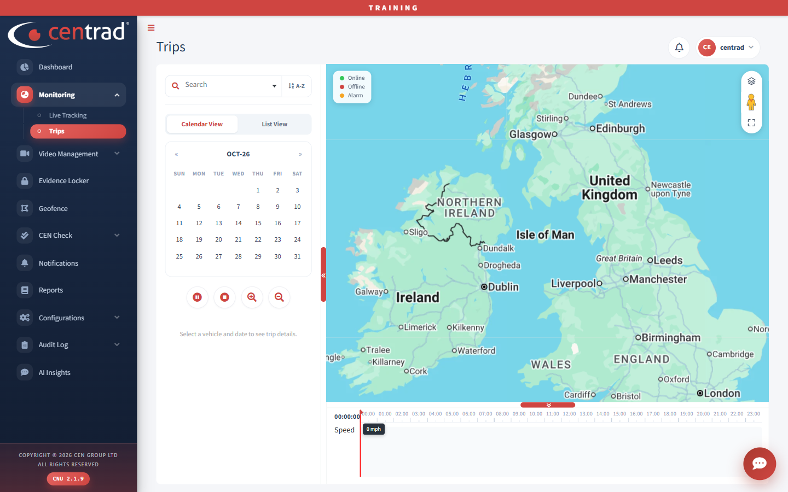

# Trips

Look at a vehicle's trips for a date you choose.

## See a vehicle's trips
1. Open **Monitoring > Trips**.
2. Use **Search** to find and select a vehicle.
3. Choose **Calendar View** or **List View**.
4. In the calendar, pick a date. Use the arrows to change month.

Until you choose, the page shows *Select a vehicle and date to see trip details*.

## On the page
- A map shows the area, with the same legend as Live Tracking.
- A timeline at the bottom runs from 00:00 to 23:00 and has a **Speed** row.
- Buttons under the calendar include pause, stop, zoom in and zoom out.

## See also
- [Live Tracking](live-tracking.md)
- [Video Playback](../video-management/video-playback.md)
- [Reports](../reports.md)
