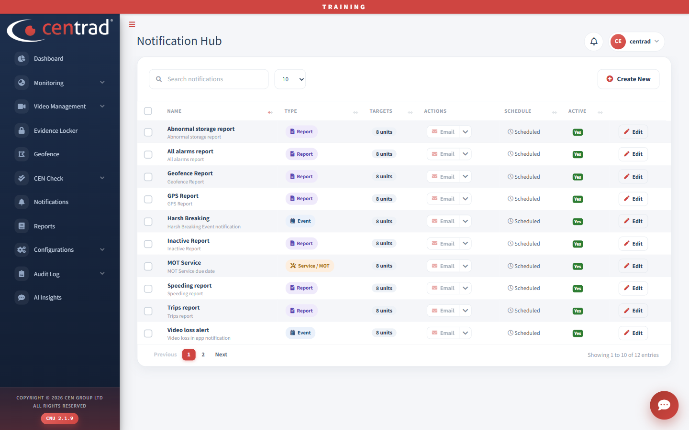

# Notifications

The **Notification Hub** lists your notifications and how each one works.

## On the page
- Click **Create New** to add a notification.
- Click **Edit** on a row to change it.
- Use the search box to find one.

## What each row shows

| Column | What it shows |
|---|---|
| **Name** | For example *Abnormal storage report*, *Harsh Braking* or *Video loss alert*, with a short description under it. |
| **Type** | For example *Report*, *Event* or *Service / MOT*. |
| **Targets** | How many units it covers, for example *8 units*. |
| **Actions** | How you are told, for example *Email*. |
| **Schedule** | For example *Scheduled*. |
| **Active** | *Yes* when it is switched on. |

## See also
- [Reports](reports.md)
- [Event Center](video-management/event-center.md)
