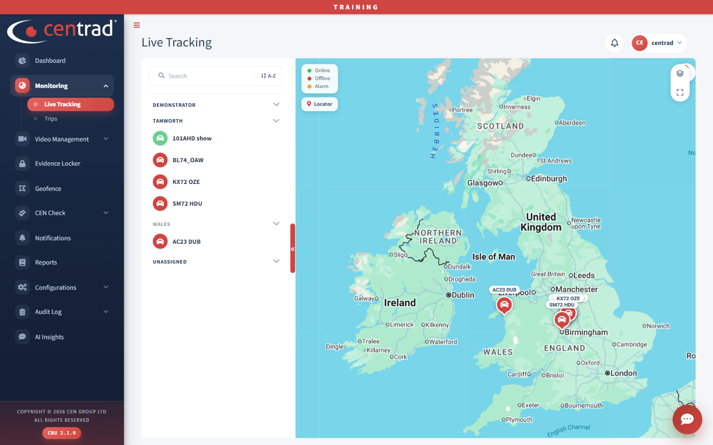

# Find a vehicle on the map

1. Open **Monitoring > Live Tracking**.
2. Type in **Search**, or click a group in the list on the left to open it.
3. Find your vehicle in the list. The map shows each vehicle with its name.

A green vehicle is online. A red vehicle is offline.

Full details: [Live Tracking](../monitoring/live-tracking.md).

## See also
- [Live Tracking](../monitoring/live-tracking.md)
- [Trips](../monitoring/trips.md)
- [Live Video](../video-management/live-video.md)
