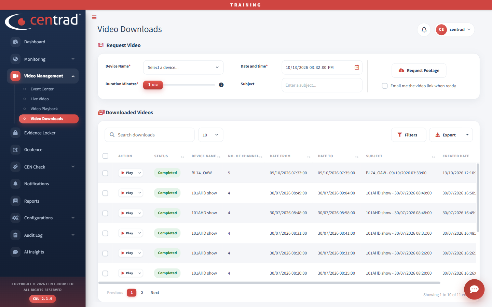

# Request a video clip

1. Open **Video Management > Video Downloads**.
2. Under **Request Video**, choose the **Device Name**, the **Date and time**, and the **Duration Minutes**.
3. If you like, add a **Subject** and tick **Email me the video link when ready**.
4. Click **Request Footage**.
5. Find your request under **Downloaded Videos**. When **Status** shows **Completed**, click **Play**.

Full details: [Video Downloads](../video-management/video-downloads.md).

## See also
- [Video Downloads](../video-management/video-downloads.md)
- [Video Playback](../video-management/video-playback.md)
- [Evidence Locker](../evidence-locker.md)
