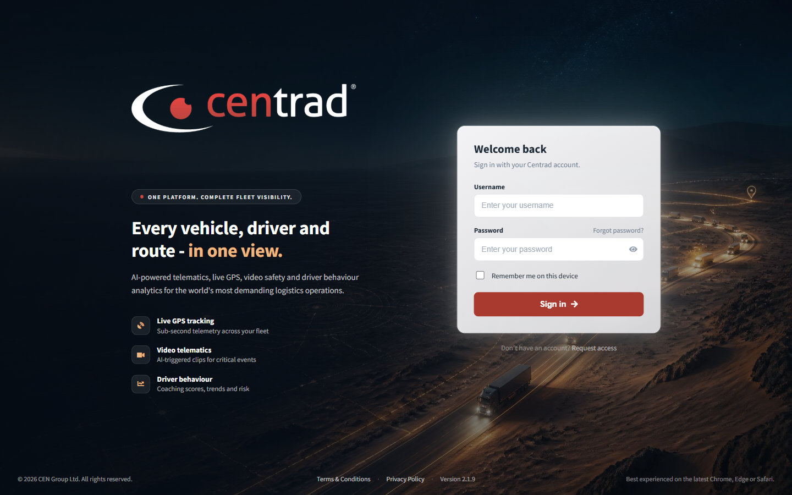
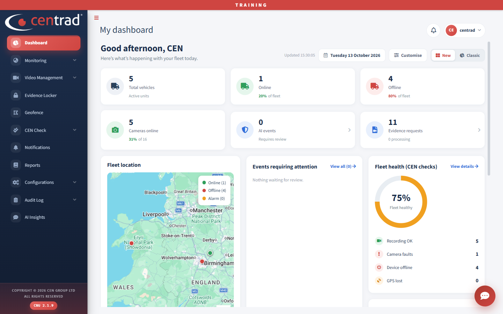

# Sign in and find your way around

Sign in, then use the menu on the left to open any page.

## Sign in
1. Type your **Username**.
2. Type your **Password**.
3. Click **Sign in**.

Need an account? Click **Request access**. The sign-in page also has **Forgot password?** and a **Remember me on this device** tick box.

## Find your way around

- **Menu (left):** Dashboard, Monitoring, Video Management, Evidence Locker, Geofence, CEN Check, Notifications, Reports, Configurations, Audit Log and AI Insights. A small arrow means the item opens to show more pages.
- **Top right:** the notification bell and your user name.
- **Bottom right:** a round chat button that opens the [Cenhub Assistant](../cenhub-assistant.md).

After you sign in you land on the [Dashboard](../dashboard.md).

## See also
- [Dashboard](../dashboard.md)
- [Requirements](../requirements.md)
