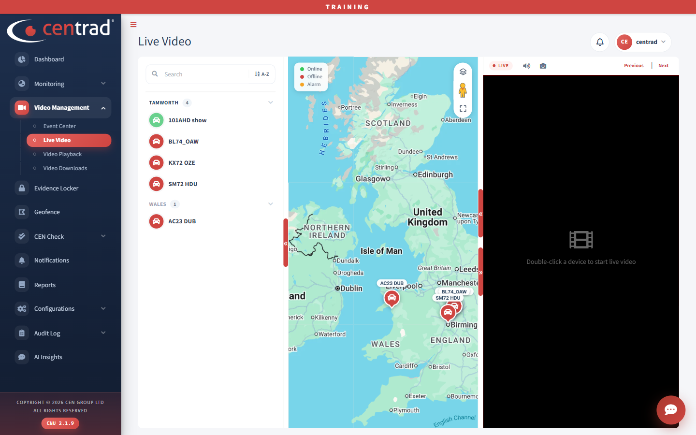

# Watch live video

1. Open **Video Management > Live Video**.
2. Find the vehicle in the list on the left, or on the map.
3. **Double-click the device.** The video appears on the right, marked **LIVE**.
4. Click **Previous** or **Next** to change channel.

Full details: [Live Video](../video-management/live-video.md).

## See also
- [Live Video](../video-management/live-video.md)
- [Video Playback](../video-management/video-playback.md)
- [Live Tracking](../monitoring/live-tracking.md)
