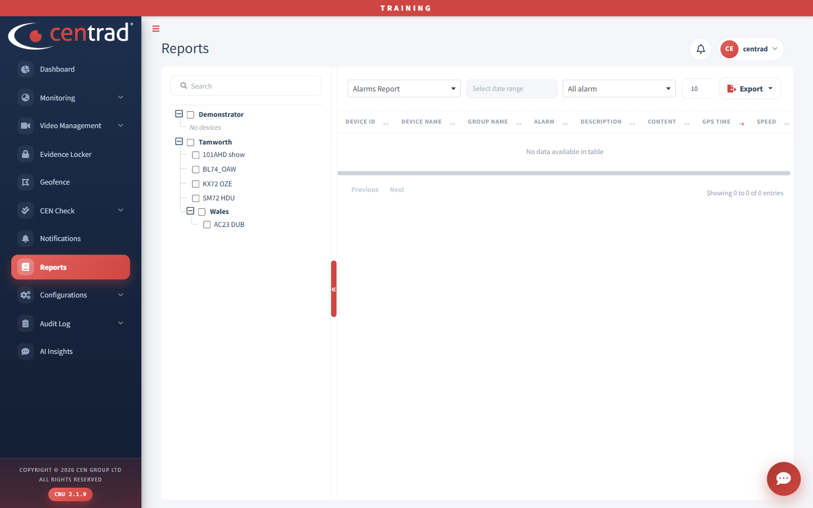

# Reports

Run a report for the vehicles and dates you choose.

## Run a report
1. Open **Reports**.
2. In the first drop-down, choose the report. The page opens on **Alarms Report**.
3. Click **Select date range** and choose the dates.
4. In the alarm drop-down, choose which alarm you want. It starts on **All alarm**.
5. On the left, tick the groups or vehicles to include. Use **Search** to find one.
6. Read the results in the table.
7. Click **Export** to save them.

The columns include **Device ID**, **Device Name**, **Group Name**, **Alarm**, **Description**, **Content**, **GPS Time** and **Speed**.

## See also
- [Notifications](notifications.md)
- [Trips](monitoring/trips.md)
- [Event Center](video-management/event-center.md)
