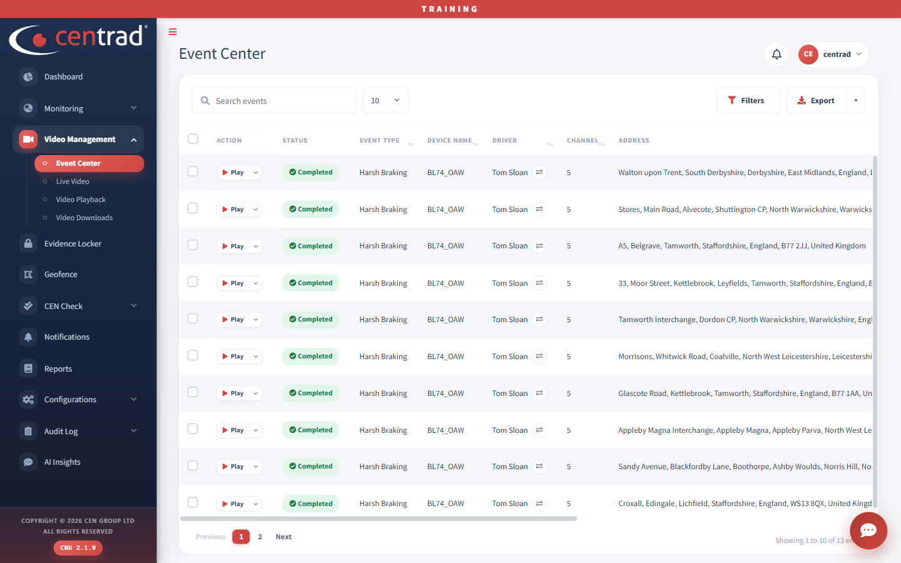

# Event Center

Review recorded events and watch their video.

## Watch an event
1. Open **Video Management > Event Center**.
2. Find the event in the list.
3. Click **Play** on its row.

## Find and save events
- Type in **Search events** to search the list.
- Click **Filters** to narrow the list.
- Click **Export** to save the list.
- Use the number box to choose how many rows to show, and **Previous** and **Next** to change page.

## What each row shows

| Column | What it shows |
|---|---|
| **Status** | For example *Completed*. |
| **Event Type** | For example *Harsh Braking*. |
| **Device Name** | The vehicle. |
| **Driver** | The driver for the event. |
| **Channel** | The camera channel. |
| **Address** | Where the event happened. |

## See also
- [Video Downloads](video-downloads.md)
- [Evidence Locker](../evidence-locker.md)
- [Dashboard](../dashboard.md)
