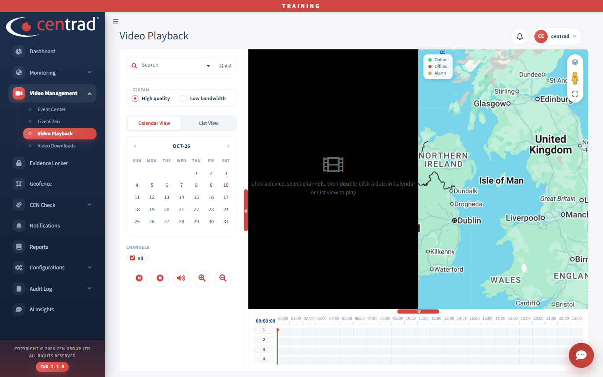

# Video Playback

Watch recorded video for a vehicle and a date.

## Play a recording
1. Open **Video Management > Video Playback**.
2. Use **Search** to find and select a device.
3. Under **Stream**, choose **High quality** or **Low bandwidth**.
4. Choose **Calendar View** or **List View**.
5. Under **Channels**, keep **All** ticked, or choose the channels you want.
6. **Double-click a date** to start playback.

Before you start, the video area says *Click a device, select channels, then double-click a date in Calendar or List view to play*.

## On the page
- Buttons under **Channels** include pause, stop, sound, zoom in and zoom out.
- The timeline at the bottom has one row for each channel and runs from 00:00 to 23:00.
- A map on the right shows the area.

## See also
- [Live Video](live-video.md)
- [Video Downloads](video-downloads.md)
- [Trips](../monitoring/trips.md)
